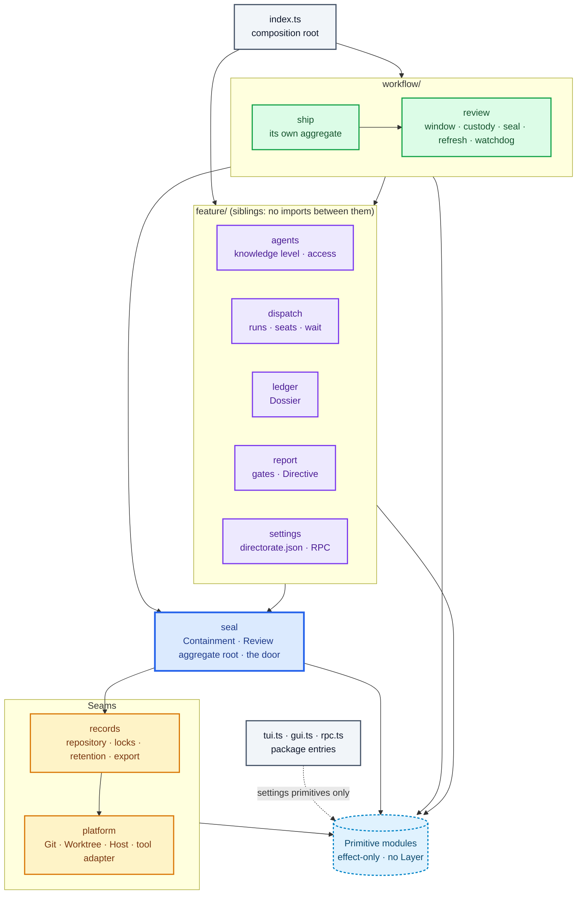

# Architecture

`src/` is an Effect Schema–first model organized as vertical slices, with ideas borrowed from Domain-Driven Design. This document is the ownership map: which slices exist, what each owns, how they may depend on each other, and which code may change which part of a review. `test/architecture.test.ts` holds the code to the mechanical parts of it ([Verification](#verification) lists what is and is not checked).

[`src/AGENTS.md`](src/AGENTS.md) holds the Effect mechanics (branded classes, tagged unions, decoding, numbers). [`THEME.md`](THEME.md) holds the voice. This file holds the shape.

## Two forces

Two constraints decide most of the shape.

1. **The seal is one stored record with many owners.** `seal.json` holds about 40 fields, changed by several concerns: what was sealed, who read what, the time window, who holds the review, which subagents ran, what the Directive said, and which ship loop the review belongs to. Its encoded shape is a compatibility contract and must stay flat. So the record is _composed_ from field groups that each concern owns, and every write goes through one guarded door.
2. **The settings GUI bundle must stay `effect`-only.** `gui.ts` and `tui.ts` run the configure flow in the app, not on the server. The desktop app supplies only `effect` and `@opencode/plugin/{gui,rpc}` (the terminal app supplies `@opencode/plugin/{tui,rpc}`). So the settings schemas, and every schema they reach, must be importable without pulling in a service or a host package.

Both lead to the same rule: **schemas live in primitive modules, which import no service.** The seal record and the GUI import primitives only; services and host-facing behavior sit in each slice's entry and internal modules.

## Layout

```text
src/
├── index.ts                composition root: builds the Layers, runs each slice's registration in order, owns the tool list and command transforms, wires slices to each other
├── tui.ts · gui.ts · rpc.ts package entries (rpc.ts re-exports feature/settings/rpc.ts by name)
├── exclusions.ts*          shared kernel: withheld paths, dependency directories, scope matching
├── platform/               process and host capabilities, and the OpenCode adapter
│   ├── platform.ts         entry: nodeLayer, Git, Worktree, Host, ProcessIdentity, host-record readers, tool adapter
│   ├── stored.ts*          since · orLegacyTrue · Time · Count · sortedFields · invalid
│   ├── error.ts* · utf8.ts* · hash.ts
│   ├── git.ts · command.ts · worktree.ts · host.ts · process-identity.ts
│   ├── host-record.ts      activity · turns · locationKey · createdAt · foreign
│   └── tool.ts             adapter (tools and hooks) · DefineTool · ToolCatalog · actor · error → model text
├── records/                review records: where they live, how long they stay, how they leave
│   ├── records.ts          entry: Records, StateRoot, the ActiveSeal port, export tools and command
│   ├── repository.ts · locks.ts · retention.ts · state-root.ts
│   ├── active-seal.ts      the ActiveSeal port (seal/ provides it)
│   └── export.ts · export-tools.ts · archive.ts
├── seal/                   Containment: the Review aggregate root
│   ├── seal.ts             entry: Sessions and the door, its writers, openReview, read tools, capture
│   ├── record.ts* · target.ts* · region.ts* · coverage.ts*
│   ├── sessions.ts         session ↔ seal bindings and the door
│   └── capture.ts · ends.ts · diff.ts · content.ts · views.ts · tools.ts · repo-path.ts
├── feature/
│   ├── agents/             agents.ts · agent.ts* · registration.ts · access.ts
│   ├── dispatch/           dispatch.ts · lifecycle.ts* · seat.ts* · events.ts · launch.ts · wait.ts
│   ├── ledger/             ledger.ts · entry.ts* · decide.ts* · tools.ts
│   ├── report/             report.ts · directive.ts* · gates.ts* · render.ts* · filing.ts
│   └── settings/           settings.ts · file.ts* · configure-flow.ts* · configure-client.ts* · rpc.ts* · store.ts · configure.ts · prefix.ts
└── workflow/
    ├── review/             review.ts · window.ts* · custody.ts* · request.ts* · ship-link.ts* · lifecycle.ts · interrupted.ts · tools.ts · command.ts · prefix.ts · watchdog.ts
    └── ship/               ship.ts · state.ts* · step.ts* · runner.ts
```

`*` marks a **primitive module** (`PRIMITIVE_MODULES` in `test/architecture-graph.ts`). In each slice directory, the module named for the directory is its **entry**; every other unmarked module is **internal** to the slice. The test fails if this block and the tree disagree: every `.ts` file under `src/` must appear here, and the `*` marks must equal `PRIMITIVE_MODULES`.

## Slice anatomy

A slice is a directory named for one bounded context. It has two public surfaces:

| Surface | File | Contains | Imports | Imported by |
| --- | --- | --- | --- | --- |
| **Primitives** | any `*`-marked module | Schema classes, literals, tagged unions, tagged errors, functions and methods over them, prompt copy, defaults | `effect`, `effect/*`, and other primitive modules | anyone: other slices, the seal record, the package entries, the GUI bundle |
| **Entry** | `<slice>/<slice>.ts` | named re-exports: its `Context.Service` and `Layer`, its registrations (`registerReport`, `reviewTools`, `ledgerTools`, `registerDispatch`, …), and the workflows other slices call | its own slice, primitives, and the entries of lower bands | slices in higher bands and `index.ts` |

The rules behind the table:

- **Primitives.** A primitive imports only `effect`, `effect/*`, and other primitive modules. One exception: `feature/settings/rpc.ts` also imports `@opencode/plugin/rpc`, because the settings RPC definition is built with `Rpc.define` and both apps supply that package. A primitive needs no `Layer`. It may read the clock (`budget` in `workflow/review/window.ts`, `budgetLine` in `feature/agents/agent.ts`), but it never yields a service someone must provide. That is why `platform/hash.ts`, which needs `Digest`, is not a primitive. Most primitives are pure; `feature/settings/configure-client.ts` is the exception. It imports only `effect` and settings primitives, so the GUI may load it, but it runs the configure flow at the host's Promise boundary (`Effect.runPromiseExit` in `configureFromHost`).
- **Entries.** An entry re-exports selected names: only those something outside the slice imports. `export *` and namespace re-exports are rejected. Slices do not share a uniform `register()`. Each exposes registrations named for what they register, with whatever parameters it needs (see [Ports point up](#ports-point-up)).
- **Internal modules** (`seal/capture.ts`, `feature/dispatch/events.ts`, `workflow/review/watchdog.ts`, …) are imported only from inside their own slice.
- **Host types** (`@opencode/*`) appear in entries and internal modules of several slices: `platform/`, `seal/sessions.ts`, the agents' and dispatch's hooks, the ship runner. They never reach a primitive.
- **Tests** sit outside the bands. They may import any module directly, including a slice's internal modules.

## Dependency bands



The bands, lowest first: `platform`, `records`, `seal`, the five features (one band), `workflow/review`, `workflow/ship` (`SLICE_BANDS` in `test/architecture-graph.ts`).

Rules:

- **Imports point down.** An entry or internal module may import its own slice, any primitive, and the entry of any slice in a lower band. A primitive imports only primitives, in any slice.
- **Features are siblings.** A feature never imports another feature's entry. Features share through primitives and the seal aggregate; only workflows compose features. `workflow/ship` is one band above `workflow/review` and imports its entry.
- **No value-import cycles.** `seal/record.ts` imports the field-group modules of its owners (`workflow/review/window.ts`, `feature/dispatch/lifecycle.ts`, …), so those modules take `Seal` by `import type` only. Type-only cycles are fine because they are erased. The modules that need `Seal` as a value (`records/repository.ts` for `SealJson`, `seal/sessions.ts` for the door's revision schemas, `feature/report/filing.ts`, `feature/report/render.ts`, `workflow/review/lifecycle.ts`, `workflow/ship/step.ts`) import it and are imported by nothing `seal/record.ts` needs. A class used before its module initializes breaks plugin load.
- **Package entries stay at `src/`.** `index.ts`, `tui.ts`, `gui.ts`, and `rpc.ts` are the only root modules besides `exclusions.ts`. `index.ts` imports only slice entries and primitives. `tui.ts` and `gui.ts` import only primitives and `rpc.ts`. `rpc.ts` imports only primitives.

### Ports point up

When a lower slice needs something from a higher one, or a feature needs something from a sibling, the lower side declares what it needs and `index.ts` wires in the implementation. A capability with no registration state is a `Context.Service` provided in a `Layer`. A callback into closure state built at registration is a registration parameter. These are all the wires `index.ts` makes:

| What | Declared by | Supplied by | How |
| --- | --- | --- | --- |
| `ActiveSeal` (a session's active seal and directory) | `records/` | `seal/` (`sealLayer`, from `Sessions`) | service port |
| `filed`: forget a reported seal's frozen settings line | `registerReport` (`feature/report`) | `settingsLines().forget` (`feature/settings`) | registration parameter |
| `recovered`: tell a recovered review's caller its Directive | `registerReport` (`feature/report`) | `notifyRecoveredReview` (`workflow/review`) | registration parameter |
| `autoReport`: file a Directive without the Liaison (abandon, deadline) | `reviewTools` and `watchdog` (`workflow/review`) | `registerReport(…).autoReport` (`feature/report`) | registration parameter |
| `sealed`: hand each new seal to the ship loop, which may own it | `reviewTools` (`workflow/review`) | `registerShip().sealed` (`workflow/ship`) | registration parameter |
| `recoverShips`: which ship owns each seal the watchdog recovers | `watchdog` (`workflow/review`) | `registerShip().recoverShips` (`workflow/ship`) | registration parameter |
| `before`: a session-event listener ahead of dispatch's own handler | `registerDispatch` (`feature/dispatch`) | `registerShip().sessionEvent` (`workflow/ship`) | registration parameter |
| `settingsLine`: push the Liaison's `[directorate settings]` line | `sessionPrefix` (`workflow/review`) | `settingsLines().push` (`feature/settings`) | registration parameter |

`index.ts` also owns the two host transforms every slice contributes to: the command transform (`/directorate-export`, `/directorate-review`, `/directorate-ship`) and the tool transform. The tool transform registers every slice's tools in one fixed order, which is part of the prompt prefix. It holds no tool bodies, hooks, or review policy.

Not every cross-slice call is a port. `workflow/ship` calls review's `shipStamp` and `interruptedReview` through review's entry, which is one band down.

## The slices

### `seal/`: Containment

The Review aggregate root: what is under review, frozen, and who has read which part of it.

- **Owns:** `Seal` (the composed record), the `Containment` field group, and the root invariants; `Target`, `FileEntry`, `Region`, `Anchor`, `Side`; coverage marks and `Disposition`; capture (target ends, diff, snapshot, regions, fingerprints, drift check); sealed content (quote and evidence checks, installed dependencies); paged views; `RepoPath`, `RepoScope`, `LineRef`; `Sessions` (session ↔ seal bindings, the door, and its writers); `openReview`. Provides `ActiveSeal`.
- **Tools:** `directorate_diff`, `directorate_read`, `directorate_ls`, `directorate_grep`, `directorate_history`, `directorate_coverage`.
- **Field groups:** Containment, Coverage marks. **Artifacts:** `diff*.patch`, `snapshot*/` (persisted by `records/`).

### `feature/agents/`: Agents (knowledge level)

What every agent of a kind _is_ and _may do_. Reference data; it stores nothing.

- **Owns:** `AgentIdSchema` and the `Agent` class, with instances `Liaison`, `Auditor`, `Seat`, `Compliance` and one registry (`agentOf`, with `agentNamed` and `dispatchableNamed` for host-supplied names); `Actor`; each agent's per-phase orders and dispatch rights; the ticking budget footer (`budgetLine`) and the cache-stable prompt notice (`budgetNotice`) an agent reads (Window × Agent).
- **Hooks:** agent and skill registration from `agents/*.md` and `skills/` (`registerBundled`); `permission.evaluate` (only Directorate agents call review tools, only the Liaison dispatches, no new Auditors or Seats once the budget drains, no new dispatches once it locks); harness withholding and lockdown tool stripping in the session prefix (`withholdHarness`, `lockdown`).

```ts
export class Agent extends Schema.Class<
  Agent,
  { readonly brand: unique symbol }
>("directorate/Agent")({
  dispatches: Schema.Array(AgentIdSchema),
  id: AgentIdSchema,
  launchableIn: Schema.Array(PhaseSchema),
  orders: Schema.Record(PhaseSchema, Schema.String),
  title: Schema.String,
}) {
  mayLaunch(child: Agent, phase: Phase) {
    return (
      this.dispatches.includes(child.id) && child.launchableIn.includes(phase)
    );
  }

  orderFor(phase: Phase) {
    return this.orders[phase];
  }
}

export const Compliance = Agent.make({
  dispatches: [],
  id: "directorate_compliance",
  launchableIn: ["normal", "drain"],
  orders: {
    drain:
      "DRAIN: finish the entry in hand; decide the rest only where evidence is clear, then hand off",
    locked: "LOCKED: record proved verdicts and stop",
    normal: "verify",
  },
  title: "Compliance",
});
```

### `feature/dispatch/`: Dispatch (operational level)

Each Auditor, Seat, or Compliance run the Liaison sends out in _this_ review.

- **Owns:** the `Dispatch` entity as a tagged union (`Launching → Running → Completed | Failed`, and a completed run that works again is `Running` again) and its transitions; seat assignments (`Seat`: model and variant), `ModelRef`, the default panel (`DEFAULT_PANEL`); follow-ups (a follow-up to a finished run is a new run; to a running one, it joins); failures and unanswered questions.
- **Agents as stored:** a dispatch stores its agent as a string, because older records may hold any name. Where behavior depends on the agent (seat status, unanswered questions, display names), it resolves the string to an `Agent` with `dispatchableNamed`.
- **Tools and hooks:** `directorate_wait`; subagent `execute.before` (assigns the next open seat) and `execute.after`; the **one** ordered session-event consumer, which hands each event to the ship loop's listener first and then applies it to the runs (`session.created` is always handled before a child's terminal events); settling runs after a reload (`settleChildren`).
- **Field group:** Dispatches (stored as `children`).

**Agents or dispatch?** If it is true of every Auditor, it belongs in `agents/`. If it is true of _this_ Auditor in _this_ review, it belongs in `dispatch/`. The `directorate_seat` agent is knowledge; a seat assignment (one model on one panel position) is operational.

### `feature/ledger/`: Dossier

Findings and their verification.

- **Owns:** the `Entry` entity; `Verdict`, `Note`, and `Carried` value objects; `Ledger`, the `ledger.json` root, and its codec `LedgerJson`; `Severity`, `Kind`, `Lens`, entry statuses; decision authority as a specification over `Agent` (only the Liaison and Compliance decide; the Liaison decides open minor entries other sessions raised, never affirming the Liaison's own; no session confirms or resolves its own entry; only carried findings resolve, and only Compliance decides a carried verified finding); `reopen` on refresh, carrying entries into a re-check, and reopening duplicates of a refuted or resolved entry.
- **Shape:** every status carries the same fields, so `Entry` is one branded class with a `status` field rather than a union. Changes are named transitions (`Ledger.filed`, `Ledger.noted`, `Ledger.withEntries`, `Entry.decided`, `Entry.carriedAs`, `decide`, `reopen`) that rebuild through the constructors. Stored fields such as `lens` and actors' agent names stay arbitrary strings.
- **Tools:** `directorate_ledger_add`, `directorate_ledger_verdict`, `directorate_ledger_list`, `directorate_note`.

### `feature/report/`: the Directive

The protocol gates and the Directive they let through.

- **Owns:** `Gates`, `Directive`, and the `Protocol` field group; the Directive's status and reasons (`assess`); the five protocol gates as specifications (Coverage, Seats, Active Personnel, Containment Drift, Unverified Dossier); rendering and filing (`finalize`); automatic reporting for abandoned or expired reviews (`autoReport`); the `report.md` artifact.
- **Tools:** `directorate_report`.
- **Field group:** Protocol & Directive.

### `feature/settings/`: Settings and Configure

`directorate.json` and the dialogs that edit it.

- **Owns:** the settings file schema (`SettingsSchema`, `SettingsJson`), scope (global or project), merge and precedence, the describe line; the configure dialog flow and its host adapter (GUI-safe primitives); the settings RPC definition (`DirectorateRpc`); `SettingsStore`.
- **Tools and hooks:** `directorate_configure`; the settings RPC handlers (`configureRpc`); the `[directorate settings]` system line on each Liaison request, frozen per active seal so mid-review edits never change the prompt prefix (`settingsLines`). `/directorate-configure` runs in `tui.ts` and `gui.ts`.
- **Resolves, never defines, defaults:** a request, then the project file, then the global file, then the owner's default (minutes from `review`, seats from `dispatch`, scope and mode from `review`).

### `workflow/review/`: the review lifecycle

Opening, timing, holding, refreshing, and closing a review.

- **Owns:** `Window` and `Phase` (the budget clock: normal, then drain in the last 20% or 6 minutes if longer but never more than half, then locked at the deadline; per-mode minutes; the 1.5× panel factor; the takeover restart at half the budget, at least 5 minutes; a re-check's default of half its mode's minutes, at least 10; each phase's header and its name in refusals); `Custody` and its `Recovery` wake; `ReviewRequest`, `Mode`, `ReviewScope`, and the scope → target-kind table; create, refresh, and re-check (`createSeal`, `refreshSeal`, `recheckSeal`); the per-session start lock; resume, takeover, and abandon; the watchdog sweep and recovery wake; the Ship link stamp (`shipStamp`).
- **Tools, commands, and hooks:** `directorate_seal`, `directorate_refresh`, `/directorate-review`; the session prefix hook (`sessionPrefix`).
- **Field groups:** Window, Custody, and the Ship link on the ship's behalf (see [`workflow/ship/`](#workflowship-the-ship-loop)).

The budget belongs to the review, not to agents: its length varies per review (mode, panel, settings, takeover). What varies per agent is how it behaves in each phase, and that lives on `Agent`.

### `workflow/ship/`: the ship loop

Review, fix, and re-check until the Directive is clean or the loop pauses.

- **Owns:** ship state as a tagged union (`Waiting`, `Active`, `Paused`, `Complete`) decoded from its stored `status` shape, with its transitions; the next-step policy and its decisions (`Proceed`, `Pause`, `Conclude`), read from the saved Directive and never from the model's reply; the 6-review and 30-round limits; the kickoff text.
- **Commands and hooks:** `/directorate-ship`; its own `context` and `experimental.idle` session hooks; a session-event listener that dispatch's one ordered consumer calls before its own handler; auto-resume after reload or restart.
- **Storage:** `ship:<sessionID>` in OpenCode plugin storage. Ship is its own aggregate.

**The Ship link.** A seal's `ship` field names the ship that owns the review. Ship never writes the seal. When ship attaches a new seal, it calls review's `shipStamp` (`workflow/review/lifecycle.ts`, exported from the review entry) with its id. `shipStamp` performs the write through the door with the `ShipLink` writer and the `shipped` transition (`workflow/review/ship-link.ts`). The watchdog also stamps an older seal it finds owned by a ship, with `shipped` under the `Watchdog` writer.

### `records/`: Records

Where review records live, how long they stay, and how they leave.

- **Owns:** the review-record repository `Records` (`seal.json`, `ledger.json`, `report.md`, patches, snapshots), typed with codecs from the owners' primitives; `StateRoot`; `mutation.lock` and the ship locks; atomic writes; 31-day retention; listing; the unredacted export ZIP, its manifest, and transcript collection; the `ActiveSeal` port.
- **Tools and commands:** `directorate_export`, `directorate_export_list`, `/directorate-export`.

### `platform/`: seams and the OpenCode adapter

Process and host capabilities with no review policy.

- **Owns:** `Git` (and the command runner), `Worktree`, `Host`, `ProcessIdentity`, and `nodeLayer`; host-record readers (`activity`, `turns`, `locationKey`, `createdAt`, `foreign`); the tool and hook adapter (`adapter`, `DefineTool`, the `ToolCatalog`, `actor`, which decodes a tool call's agent and session into an `Actor`) and mapping slice errors to the text the model sees; `recover` and `ignore`; UTF-8 and SHA-256 helpers; stored-schema helpers (`since`, `orLegacyTrue`, `Time`, `Count`, `sortedFields`).
- **Not the only place host types are read.** Other slices read host events and session records in their own entries and internal modules. What `platform/` guarantees is narrower: tool calls reach slices as an `Actor`, and host types never reach a primitive.

### `exclusions.ts`: withholding

A shared kernel: secret-like paths, dependency directories, and scope matching. Every slice that shows or captures files uses it; changing it changes all of them.

## Ownership

### One aggregate, one door

A review is one aggregate: the `Seal` root plus its `Ledger`, guarded by one `mutation.lock`. Every write to a review goes through `Sessions` in `seal/sessions.ts`:

```ts
// seal/sessions.ts (shape)
mutate(sealId, writer, transition) =>
  records.withLock(sealId, () => {
    const seal = load(sealId); // a ToolCall's session is bound to the seal on the way, if it participates
    const admitted = admit(seal, writer); // AdmissionSchema: write, read (run, save nothing), or skip (do not run)
    if (skips(admitted)) return;
    const revision = transition({ seal, ledger, checkpoint }); // ledger loads only if the transition asks
    if (writes(admitted)) persist(revision); // only the parts the revision returns
    return revision.out;
  });
read(sealId, toolCall, body); // under the lock, the same guards as a ToolCall; writes nothing
openReview(id, attempt); // a review that does not exist yet: its first seal and ledger, written together
```

**Writers.** The writer says who writes, and so which guards apply. The union is:

| Writer | Who | On an open seal | On a reported seal |
| --- | --- | --- | --- |
| `ToolCall` | a tool call by an `Actor` | guards below | refused (`SealReported`), or with `reported: "shown"`, run and nothing saved |
| `HostEvent` | the ordered session-event consumer, subagent hooks, settling runs after a reload | written | left alone silently |
| `Watchdog` | the deadline sweep, stamping a ship on an older seal | written | left alone silently |
| `RecoveryWake` | the watchdog waking a stalled Liaison (uninterruptible once loaded) | written | left alone silently |
| `AutoReport` | filing without the Liaison (abandon, deadline) | written | left alone silently |
| `ShipLink` | `shipStamp` stamping the ship's id | written | written |
| `Takeover` | `directorate_seal resume` by an `Actor` | written | run and nothing saved; the transition refuses it itself |

A `ToolCall` carries three options, each with a default. The door reads them through `ToolCall`'s getters `ownerOnly`, `catalogChecked`, and `showsReported`:

- `callers`: `"participants"` (default) or `"owner"`. An owner-only tool needs the session that sealed (`NotOwner`).
- `lockdown`: `"catalog"` (default) or `"exempt"`. Once the budget locks, a catalog-checked call runs only if the `ToolCatalog` says the caller's agent keeps the tool (`Lockdown`). The door checks this under the seal's lock, because a model step that began before the deadline still offers tools the prefix strips at lockdown.
- `reported`: `"refused"` (default) or `"shown"`.

**Transitions.** A transition receives the review: the seal as loaded, its ledger (an Effect, loaded only if asked for), and `checkpoint`. It returns a `Revision`: `out` plus what it changed, either `RevisedSchema` (an optional `seal` and `ledger`) or, when the Directive is filed, `FiledSchema` (a `seal` plus a `report`). Only the parts returned are saved: the report with its reported seal, the seal and ledger together, or either alone. A transition that returns neither writes nothing. `checkpoint(next)` saves `next` before the transition goes on to cause an outside effect; the recovery wake uses it to save its intent before sending the wake. The door still saves the final result.

**Who reaches the seal without the door.** `directorate_read`, `directorate_ls`, `directorate_grep`, `directorate_history`, and `directorate_ledger_list` resolve the seal with `Sessions.sealFor`, without the lock or the door's guards, because they write nothing. At lockdown they are withheld from callers by tool stripping in the session prefix, not refused by the door.

**Field-group ownership.** Each field group is rebuilt only through its owner's transition functions, and those call `Seal`'s `with<Group>` methods. A caller's transition may _compose_ another owner's transition: dispatch's event handler calls review's `halted` when the user interrupts the Liaison; report's auto-report calls review's `abandoned`; refresh composes seal's `repinned` and `carryMarks`, report's `driftCleared`, and ledger's `reopen`. A caller never rebuilds another owner's group itself. `Seal.make` and `new Seal` appear only in `seal/record.ts`.

Nothing lints or tests ownership. It holds by convention and review.

### The composed record

`seal/record.ts` spreads each owner's stored field group, so `seal.json` stays flat. Each group has one rebuild method on `Seal`. The owner's transitions take the seal by `import type` and return `seal.with<Group>(…)`, so no field-group module needs a value import of `seal/record.ts`:

```ts
export class Seal extends Schema.Class<Seal, { readonly brand: unique symbol }>(
  "directorate/Seal"
)(
  // Keys stay in alphabetical order across the field groups: seal.json is encoded in field order.
  Schema.Struct(
    sortedFields({
      ...Containment.fields, // seal
      ...StoredWindow.fields, // workflow/review
      ...Custody.fields, // workflow/review
      ...Protocol.fields, // feature/report
      children: since(list(DispatchFromStored), []), // feature/dispatch
      ship: opt(Schema.String), // the Ship link
    })
    // Spreading StoredWindow's fields drops its check; the root re-applies it.
  ).check(windowCheck)
) {
  static open(pins, window, custody) {} // a new review at generation 0, before capture: Containment's Pins, nothing Captured
  get pinsCommit() {} // its post-image is a commit, not the working tree
  get window() {} // the Window value object
  withContainment(containment) {} // seal: capture, re-pin, coverage marks
  withWindow(window) {} // workflow/review
  withCustody(custody) {} // workflow/review
  withProtocol(protocol) {} // feature/report
  withDispatches(children) {} // feature/dispatch
  withShip(ship) {} // stamped by workflow/review
}
```

### Field groups

| Field group | Owner | Fields | Changed only by |
| --- | --- | --- | --- |
| Containment | `seal` | `id` `repo` `target` `baseSha` `baseTip` `headSha` `postImage` `fingerprint` `sigs` `files` `deleted` `regions` (geometry) `gen` `refreshes` `description` `mode` `lensesOff` `panel` `question` `recheckOf` | `Seal.open` (`seal/record.ts`); `capture` and `repinned` (`seal/capture.ts`); called by review's `createSeal`, `refreshSeal`, and `recheckSeal` |
| Coverage marks | `seal` | `regions[].readBy` `ownerRead` `offsets` `disposition` `note` | `markShown`, `dispose`, `carryMarks` (`seal/coverage.ts`); `carryMarks` on refresh and re-check |
| Window | `workflow/review` | `createdAt` `deadline` `budgetMinutes` | `Seal.open` with `Window.open` at sealing; `restarted` (`workflow/review/window.ts`) with `Window.takeover` or a named budget on resume |
| Custody | `workflow/review` | `owner` `ownerSession` `previousOwnerSessions` `resumedAt` `halted` `abandoned` `host` `pid` `recovery` | `started` (through `Seal.open`), `resumedBy`, `halted`, `abandoned`, `waking`, `woken` (`workflow/review/custody.ts`) |
| Dispatches | `feature/dispatch` | `children` | `launched`, `withdrawn`, `claimed`, `enqueued`, `inboxSettled`, `finished`, `resumed`, `returned`, and `update` (`feature/dispatch/lifecycle.ts`); `followUpRecovered` rebuilds one run for `update` when runs settle after a reload |
| Protocol & Directive | `feature/report` | `gates` `directive` `reportedAt` `autoReported` `freshnessUnverified` `staleFiles` | `pushedBack`, `freshnessChecked`, `directiveFiled`, `driftCleared` (`feature/report/directive.ts`); refresh composes `driftCleared` |
| Ship link | `workflow/review`, for `workflow/ship` | `ship` | `shipped` (`workflow/review/ship-link.ts`), from `shipStamp` (`ShipLink` writer) or the watchdog (`Watchdog` writer), with the id the ship hands it |

### Artifacts

| Artifact | Schema owner | Persisted by |
| --- | --- | --- |
| `seal.json` | `seal` | `records` |
| `ledger.json` | `feature/ledger` | `records`, under the seal's lock |
| `diff.patch`, `diff.g<N>.patch`, `snapshot/`, `snapshot.g<N>/` | `seal` | `records` |
| `report.md` | `feature/report` | `records`, once |
| `mutation.lock`, directory layout, 31-day retention | `records` | `records` |
| `exports/*.zip` | `records` | `records`; never pruned with the seal |
| `ship:<sessionID>` | `workflow/ship` | `workflow/ship`, in plugin storage |
| `directorate.json` | `feature/settings` | `feature/settings` |

### Names, copy, defaults, and errors

- **Names.** Agent ids live on `Agent`. Tool names live with the tool that registers them. Neither is ever renamed: both are stored and host-facing.
- **Copy.** Phase headers (`DIRECTORATE // WINDOW`, `EVACUATION`, `LOCKDOWN`) and each phase's name in refusals live with `Phase` in `workflow/review/window.ts`; each agent's per-phase orders live on its `Agent`; each tool's description and gate text live with their slice.
- **Defaults.** Owners publish defaults: minutes per mode and the panel factor (`DEFAULT_BUDGET`, `PANEL_BUDGET_FACTOR`) and the default mode and scope (`DEFAULT_MODE`, `DEFAULT_REVIEW_SCOPE`) in `review`, the default seats (`DEFAULT_PANEL`) in `dispatch`. Settings only resolves precedence.
- **Errors.** Each slice defines branded `Schema.TaggedError`s for its expected failures, each with the `message` the model reads. The tool adapter in `platform/` maps them to tool output; there is no shared `ReviewError`.

## Tools, hooks, and commands

Each tool declares the agents that keep it once the budget locks (`lockdown` on `DefineTool`; none by default). The `ToolCatalog` collects those declarations at registration. The door's lockdown check and the lockdown tool stripping in `agents/` both read it. A tool declared `harness: false` is not part of the review harness, so agents outside The Directorate keep it.

| Tool | Slice | Reaches the seal through | Kept at lockdown by (`lockdown`) |
| --- | --- | --- | --- |
| `directorate_seal` | `workflow/review` | `openReview` (new review, re-check); `mutate` as `Takeover` (resume); `autoReport` (abandon) | none |
| `directorate_refresh` | `workflow/review` | `mutate`, owner-only | none |
| `directorate_diff` | `seal` | `mutate`, `reported: "shown"` | none |
| `directorate_coverage` | `seal` | `mutate`, owner-only | none |
| `directorate_read`, `directorate_ls`, `directorate_grep`, `directorate_history` | `seal` | `sealFor`: no lock, no guards | none |
| `directorate_ledger_add` | `feature/ledger` | `mutate` | Auditor, Seat |
| `directorate_ledger_verdict` | `feature/ledger` | `mutate` | Compliance |
| `directorate_ledger_list` | `feature/ledger` | `sealFor`: no lock, no guards | Liaison, Compliance |
| `directorate_note` | `feature/ledger` | `mutate` | Liaison, Auditor, Seat |
| `directorate_report` | `feature/report` | `mutate`, owner-only, `reported: "shown"`, **lockdown-exempt** | Liaison |
| `directorate_wait` | `feature/dispatch` | `read`, owner-only, **lockdown-exempt** | none |
| `directorate_configure` | `feature/settings` | no seal (`harness: false`) | none |
| `directorate_export`, `directorate_export_list` | `records` | `ActiveSeal` and `Records`, no door (`harness: false`) | none |

`directorate_report` and `directorate_wait` are exempt from the door's lockdown check, because they must keep working once the budget locks: filing, and waiting on runs. `directorate_wait` declares no agent, so the session prefix still strips it at lockdown; the exemption lets a call from a step that began before the deadline finish.

| Hook or command | Slice |
| --- | --- |
| `permission.evaluate` | `feature/agents` |
| Session prefix hook, one per request kind (`context`, `compaction`, `generate`), so one seal load and one pass | `workflow/review` (`sessionPrefix`), composing the next three rows in this order |
| 1. Harness withholding: an agent outside The Directorate loses the review-harness tools, and the hook stops there | `feature/agents` (`withholdHarness`) |
| 2. The Liaison's `[directorate settings]` line | `feature/settings` (`settingsLines().push`) |
| 3. Once the active seal's budget locks: the lockdown notice and tool stripping | `feature/agents` (`lockdown`) |
| Subagent `execute.before` / `execute.after`, the ordered session-event consumer | `feature/dispatch` |
| Watchdog sweep, recovery wake | `workflow/review` |
| `/directorate-review` | `workflow/review` |
| `/directorate-ship`, its `context` and `experimental.idle` hooks, its session-event listener | `workflow/ship` |
| `/directorate-export` | `records` |
| `/directorate-configure` | `tui.ts`, `gui.ts` via `feature/settings` |

Ship's own `context` hook is registered before the session prefix hook, so it runs first.

## Modeling

The mechanics are in [`src/AGENTS.md`](src/AGENTS.md). The architectural choices:

- **Value objects** are immutable, compared by value, and rebuilt on change: `Agent`, `Window`, `Target`, `Seat`, `Verdict`, `Note`. They are branded `Schema.Class`es.
- **Entities** have identity and a lifecycle: `Seal`, `Region`, `Dispatch`, `Entry`, ship state.
- **Stored lifecycles are tagged unions over one field set.** `Dispatch` (`Launching`, `Running`, `Completed`, `Failed`) and ship state (`Waiting`, `Active`, `Paused`, `Complete`) are unions of branded `Schema.TaggedClass`es. Every state shares one field set, because a stored record keeps whatever any version wrote and a round trip must be lossless; what each state actually sets is up to its transitions. Changes are named transitions that build the next state through its class. A transition that does not apply returns no change (dispatch transitions return `undefined`) or rebuilds the same state, rather than raising an invalid-transition error.
- **Stored unions keep stored shapes.** Both are stored with a `status` field, not `_tag`, and decode from and encode to that shape with `Schema.decodeTo` (`DispatchFromStored` from `StoredDispatch`, `ShipStateFromStored` from `StoredShipState`).
- **One class when the shape does not change.** Every `Entry` status carries the same fields, so `Entry` is one class with a `status` field.
- **Stored field groups and codecs are named for the stored shape.** `Containment`, `Custody`, `StoredWindow`, `Protocol`, `StoredDispatch`, and `StoredShipState` are non-class schemas without the `Schema` suffix, on purpose: each is a fixed piece of a stored contract, not a domain type.
- **Specifications** are named pure predicates on primitives: the protocol gates, decision authority, and access policy. Test them without services.
- **Application services stay inside the aggregate.** Refresh reopens ledger entries, carries coverage marks, and clears drift in one transition under one lock. It does not publish events to do it.
- **Events cross aggregates.** Ship reacts to host events and to the review's saved Directive; it never takes the seal's lock itself.

## Vocabulary

Folder and type names use the operational words that stored files, tool names, and types already use. THEME's terms are the glossary and appear in copy and in each entry module's header comment.

| Code | THEME copy |
| --- | --- |
| `seal/`, `Seal` | Containment, Containment Seal |
| `feature/ledger/`, `Ledger`, `Entry` | Dossier; Verified Findings, Unverified Leads |
| `feature/report/` | Directorate Directive, protocol holds |
| `feature/dispatch/`, `Dispatch` | Auditors, Seats, Compliance; Active Personnel |
| `Seat` (assignment) | Directorate Seat (panel model) |
| `Phase` | Window, Evacuation, Lockdown |
| `feature/settings/` scopes | Global Charter, Local Jurisdiction |

| DDD idea | Here |
| --- | --- |
| Bounded context | one slice directory |
| Knowledge vs operational level | `feature/agents` vs `feature/dispatch` |
| Aggregate and consistency boundary | the Review: `Seal` + `Ledger`, one `mutation.lock`, one door |
| Repository | `records/` (`Records`) |
| Port | `ActiveSeal`, declared by `records/`, provided by `seal/`; registration parameters wired by `index.ts` |
| Adapter to the host | `platform/`'s tool and hook adapter (`actor`, `ToolCatalog`, error mapping); host types never reach a primitive |
| Shared kernel | `exclusions.ts`, `Phase` |
| Published language | `seal.json`, `ledger.json`, `directorate.json`, ship state, the settings RPC, the tool and agent names |
| Subdomains | core: `seal`, `review`, `dispatch`, `ledger`, `report`; supporting: `agents`, `ship`, `settings`; generic: `records`, `platform` |

## Verification

`bun run check` runs lint, formatting, type checking, and every test. Three tests guard the architecture and the contracts:

- **`test/architecture.test.ts`** checks the structure:
  - imports follow the bands, primitives import only primitives (and `effect`), and no slice imports another slice's internal module;
  - there are no value-import cycles;
  - every slice has its entry, and every slice entry and package entry loads alone in a fresh Node process;
  - `gui.ts`, `tui.ts`, and `rpc.ts` reach only `effect` and the packages their hosts supply, statically, and the built `dist/gui-experimental.cjs` requires only `effect` and `@opencode/plugin/{gui,rpc}`;
  - the only files directly in `src/` are the root modules and `AGENTS.md`;
  - no slice module uses `export *` or re-exports a namespace;
  - the [Layout](#layout) block lists exactly the modules under `src/`, and its `*` marks equal `PRIMITIVE_MODULES`.
- **`test/contracts.test.ts`** checks the stored contracts. Current and legacy fixtures under `test/stored/` for `seal.json`, `ledger.json`, `directorate.json`, and ship state round-trip byte for byte. Legacy fixtures re-encode to their `*.expected.json` goldens. The first current fixture sets every encoded field, and the fixtures together cover every shape-changing union member. A `Seal` whose Window breaks `windowCheck` fails to decode, so the check survives composition.
- **`test/surface.test.ts`** checks the host-facing surface against `test/stored/surface.json`: tools in order with their input JSON Schemas, commands, agents, skills, RPC, hooks, and event subscriptions.

What is **not** mechanically checked:

- Field-group ownership: which transition may call which `with<Group>` method, and that every write goes through the door.
- Primitive purity beyond imports: a primitive could still run an Effect or hold module state.

## Where new code goes

- **A new tool:** in the slice that owns what it changes, registered from that slice's tool registration and added to the tool list in `index.ts` (its position is part of the prompt prefix). Declare its `lockdown` agents. Write through `Sessions.mutate` with a `ToolCall`, and update `test/stored/surface.json`.
- **A new stored field on the seal:** in the owning field group (`Containment` in `seal/record.ts`, under `Pins` if the review sets it at sealing or `Captured` if capture writes it; `StoredWindow`, `Custody`, `Protocol`, or `StoredDispatch`), optional or with `since` so older seals decode. Change it only through that owner's transitions and its `with<Group>` method, and add it to `test/stored/seal.json` (the first current fixture must set every encoded field).
- **A new host hook:** in the slice that owns the behavior, registered from its entry. If it needs a higher slice or a sibling, take a registration parameter and wire it in `index.ts`. Work on the session prefix goes into `sessionPrefix`'s order, not a new prefix hook. Update `test/stored/surface.json`.
- **A new setting:** in `SettingsSchema` (`feature/settings/file.ts`, a GUI-safe primitive). The owning slice publishes its default; settings only resolves precedence. Add fixtures under `test/stored/`.
- **A new agent rule:** on `Agent` in `feature/agents/agent.ts`, as data (`orders`, `dispatches`, `launchableIn`) or a method, with permission checks in `feature/agents/access.ts`. Never keep a name-keyed table beside it.
