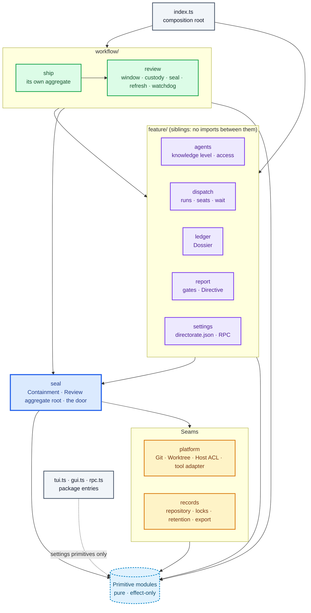

# Architecture

This document describes the target architecture of `src/`: an Effect Schema–first model organized as vertical slices, with ideas borrowed from Domain-Driven Design. It is the end state. Code that still lives in the old flat layout (`model.ts`, a 1,800-line `index.ts`) is migrating toward it; the [migration map](#appendix-migration-map) says where each piece goes.

[`src/AGENTS.md`](src/AGENTS.md) holds the Effect mechanics (branded classes, tagged unions, decoding, numbers). [`THEME.md`](THEME.md) holds the voice. This file holds the shape: which slices exist, what each owns, and how they may depend on each other.

## Two forces

Two constraints decide most of the shape.

1. **The seal is one stored record with many owners.** `seal.json` holds about 40 fields that six concerns change: what was sealed, who read what, the time window, who holds the review, which subagents ran, and what the Directive said. Its encoded shape is a compatibility contract and must stay flat. So the record is _composed_ from field groups that each concern owns, and every write goes through one guarded door.
2. **The settings GUI bundle must stay `effect`-only.** `gui.ts` and `tui.ts` reach the settings schemas through the configure flow and `rpc.ts`, and the desktop app supplies only `effect` and `@opencode/plugin/{gui,rpc}`. So schemas must be importable without pulling in any service.

Both lead to the same rule: **every slice has a pure primitive layer and a behavior layer.** The seal record and the GUI import primitives only; behavior sits above the aggregate.

## Layout

```text
src/
├── index.ts                composition root: Layers + every slice's register()
├── tui.ts · gui.ts · rpc.ts package entries (rpc.ts re-exports feature/settings/rpc.ts by name)
├── exclusions.ts           shared kernel: withheld paths
├── platform/               seams + the OpenCode anti-corruption layer
│   ├── platform.ts         entry
│   ├── stored.ts*          since · orLegacyTrue · Time · Count · invalid
│   ├── error.ts* · utf8.ts* · hash.ts*
│   ├── git.ts · command.ts · worktree.ts · host.ts · process-identity.ts
│   ├── host-record.ts      activity · turns · locationKey
│   └── tool.ts             DefineTool adapter · ToolCatalog · error → model text
├── records/                the repository and records management
│   ├── records.ts          entry: Records, ActiveSeal port, export tools
│   ├── repository.ts · locks.ts · retention.ts · state-root.ts
│   ├── active-seal.ts      the ActiveSeal port
│   └── export.ts · archive.ts
├── seal/                   Containment: the Review aggregate root
│   ├── seal.ts             entry: Sessions, read tools, capture
│   ├── record.ts* · target.ts* · region.ts* · coverage.ts*
│   ├── sessions.ts         session ↔ seal bindings + the door
│   └── capture.ts · ends.ts · diff.ts · content.ts · views.ts · tools.ts · repo-path.ts
├── feature/
│   ├── agents/             agents.ts · agent.ts* · access.ts · registration.ts
│   ├── dispatch/           dispatch.ts · lifecycle.ts* · seat.ts* · events.ts
│   ├── ledger/             ledger.ts · entry.ts* · decide.ts* · tools.ts
│   ├── report/             report.ts · directive.ts* · gates.ts* · render.ts*
│   └── settings/           settings.ts · file.ts* · configure-flow.ts* · configure-client.ts* · rpc.ts*
└── workflow/
    ├── review/             review.ts · window.ts* · custody.ts* · request.ts* · lifecycle.ts · interrupted.ts · watchdog.ts
    └── ship/               ship.ts · state.ts* · step.ts* · runner.ts
```

`*` marks a **primitive module**. Everything else in a slice directory except its entry is internal.

## Slice anatomy

A slice is a directory named for one bounded context. It has two public surfaces:

| Surface | File | Contains | Imports | Imported by |
| --- | --- | --- | --- | --- |
| **Primitives** | any `*`-marked module | Schema classes, literals, tagged unions, tagged errors, pure functions and methods, prompt copy, defaults | `effect` and other primitive modules only | anyone: other slices, the seal record, seams, the GUI bundle |
| **Entry** | `<slice>/<slice>.ts` | its `Context.Service` and `Layer`, `register()` for its tools and hooks, its public workflows | primitives, platform, records, the seal entry, and (for workflows) feature entries | slices in higher bands and `index.ts` |

Entries export selected names; no `export *` or namespace re-exports. Internal modules (`capture.ts`, `events.ts`, `watchdog.ts`) are imported only from inside their own slice.

Primitive modules never import `@opencode/*`, `@effect/platform-node`, or anything that needs a `Layer`. Host types are decoded into domain types at the edge (`platform/`) before they reach a primitive.

## Dependency bands



Rules:

- **Imports point down.** An entry may import any primitive and any entry in a lower band. A primitive imports only primitives.
- **Features are siblings.** A feature entry never imports another feature entry. Features share through primitives and the seal aggregate; only workflows compose features. `ship` may import `review`.
- **No module cycles.** `seal/record.ts` imports the field-group modules of its owners (`workflow/review/window.ts`, `feature/dispatch/lifecycle.ts`, …), so those modules must never import `seal/record.ts`. Modules that need the whole `Seal` (`feature/report/gates.ts`, `workflow/ship/step.ts`) import it and are imported by nothing it needs. A class used before its module initializes breaks plugin load.
- **Ports point up.** When something below needs something above, it declares a `Context.Service` port and the higher slice provides it in its `Layer`. `records/` declares `ActiveSeal`; `seal/` implements it.
- **Package entries stay at `src/`.** `index.ts`, `tui.ts`, `gui.ts`, and `rpc.ts` are the only root modules besides `exclusions.ts`.

## The slices

### `seal/`: Containment

The Review aggregate root: what is under review, frozen, and who has read which part of it.

- **Owns:** `Seal` (the composed record) and its root invariants; `Target`, `FileEntry`, `Region`, `Anchor`, `Side`; coverage marks and `Disposition`; capture (target ends, diff, snapshot, regions, fingerprints, drift check); sealed content (quote and evidence checks, installed dependencies); paged views; `RepoPath`, `LineRef`; `Sessions` (session ↔ seal bindings and the door). Implements `ActiveSeal`.
- **Tools:** `directorate_diff`, `directorate_read`, `directorate_ls`, `directorate_grep`, `directorate_history`, `directorate_coverage`.
- **Field groups:** Containment, Coverage marks. **Artifacts:** `diff*.patch`, `snapshot*/` (persisted by `records/`).

### `feature/agents/`: Agents (knowledge level)

What every agent of a kind _is_ and _may do_. Reference data; it stores nothing.

- **Owns:** `AgentIdSchema` and the `Agent` class, with instances `Liaison`, `Auditor`, `Seat`, `Compliance` and one registry (`agentOf`); `Actor`; each agent's per-phase orders and dispatch rights; the budget footer and the cache-stable prompt notice an agent reads (Window × Agent).
- **Hooks:** agent registration from `agents/*.md`; `permission.evaluate` (only Directorate agents call review tools, only the Liaison dispatches, no new Auditors or Seats in drain, nothing new once locked); lockdown tool stripping in the session prefix.

```ts
export class Agent extends Schema.Class<
  Agent,
  { readonly brand: unique symbol }
>("directorate/Agent")({
  id: AgentIdSchema,
  title: Schema.String,
  dispatches: Schema.Array(AgentIdSchema),
  launchableIn: Schema.Array(PhaseSchema),
  orders: Schema.Record(PhaseSchema, Schema.String),
}) {
  mayLaunch(child: Agent, phase: Phase) {
    return (
      this.dispatches.includes(child.id) && child.launchableIn.includes(phase)
    );
  }
}

export const Compliance = Agent.make({
  dispatches: [],
  id: "directorate_compliance",
  launchableIn: ["normal", "drain"],
  orders: {
    drain:
      "DRAIN: finish the entry in hand; decide the rest only where evidence is clear, then hand off",
    locked: "LOCKED: record proved verdicts and stop",
    normal: "verify",
  },
  title: "Compliance",
});
```

### `feature/dispatch/`: Dispatch (operational level)

Each Auditor, Seat, or Compliance run the Liaison sends out in _this_ review.

- **Owns:** the `Dispatch` entity as a tagged union (`Launching → Running → Completed | Failed`), each pointing at its `AgentId`; seat assignments (`Seat`: model and variant), `ModelRef`, the default panel; follow-ups (a follow-up to a finished run is a new run; to a running one, it joins); failures and unanswered questions.
- **Tools and hooks:** `directorate_wait`; subagent `execute.before` (assigns the next open seat) and `execute.after`; the **one** ordered session-event consumer (`session.created` is always handled before a child's terminal events); settling runs after a reload.
- **Field group:** Dispatches (stored as `children`).

**Agents or dispatch?** If it is true of every Auditor, it belongs in `agents/`. If it is true of _this_ Auditor in _this_ review, it belongs in `dispatch/`. The `directorate_seat` agent is knowledge; a seat assignment (one model on one panel position) is operational.

### `feature/ledger/`: Dossier

Findings and their verification.

- **Owns:** the `Entry` entity; `Verdict` and `Note` value objects; `Severity`, `Kind`, `Lens`, entry statuses; decision authority as a specification over `Agent` (Compliance decides; the Liaison decides open minor entries from Auditors or Seats; no session confirms its own entry); `reopen` on refresh; the `ledger.json` codec.
- **Tools:** `directorate_ledger_add`, `directorate_ledger_verdict`, `directorate_ledger_list`, `directorate_note`.

### `feature/report/`: the Directive

The protocol gates and the Directive they let through.

- **Owns:** `Gates`; the Directive's status and reasons; the five protocol gates as pure specifications (Coverage, Seats, Active Personnel, Containment Drift, Unverified Dossier); assess, render, and file; automatic reporting for abandoned or expired reviews; the `report.md` artifact.
- **Tools:** `directorate_report`.
- **Field group:** Protocol & Directive.

### `feature/settings/`: Settings and Configure

`directorate.json` and the dialogs that edit it.

- **Owns:** the settings file schema, scope (global or project), merge and precedence, the describe line; the configure dialog flow and client adapter (GUI-safe primitives); the settings RPC definition.
- **Tools and hooks:** `directorate_configure`; the settings RPC handler; the frozen `[directorate settings]` system line (one per active seal, so mid-review edits never change the prompt prefix). `/directorate-configure` runs in `tui.ts` and `gui.ts`.
- **Resolves, never defines, defaults:** a request, then the project file, then the global file, then the owner's default (minutes from `review`, seats from `dispatch`, scope from `review`).

### `workflow/review/`: the review lifecycle

Opening, timing, holding, refreshing, and closing a review.

- **Owns:** `Window` and `Phase` (the budget clock: normal, then drain in the last 20% or 6 minutes if longer but never more than half, then locked at the deadline; per-mode minutes; the 1.5× panel factor; the takeover restart at half the budget, at least 5 minutes); `Custody`; `ReviewRequest`, `Mode`, `ReviewScope`, and the scope → target-kind table; create, refresh, and re-check orchestration; the per-session start lock; resume, takeover, and abandon; the watchdog sweep and recovery wake.
- **Tools and commands:** `directorate_seal`, `directorate_refresh`, `/directorate-review`.
- **Field groups:** Window, Custody. It also stamps the Ship link at sealing, with the id `ship` hands it.

The budget belongs to the review, not to agents: its length varies per review (mode, panel, settings, takeover). What varies per agent is how it behaves in each phase, and that lives on `Agent`.

### `workflow/ship/`: the ship loop

Review, fix, and re-check until the Directive is clean or the loop pauses.

- **Owns:** ship state as a tagged union (Waiting, Active, Paused, Complete) decoded from its stored `status` shape; the next-step policy, read from the saved Directive and never from the model's reply; the 6-review and 30-round limits; the kickoff text.
- **Commands and hooks:** `/directorate-ship`, its own host-event subscription, auto-resume after reload or restart.
- **Storage:** `ship:<sessionID>` in OpenCode plugin storage. Ship is its own aggregate; it reacts to the review's filed Directive and never writes the seal.

### `records/`: Records

Where review records live, how long they stay, and how they leave.

- **Owns:** the review-record repository (`seal.json`, `ledger.json`, `report.md`, patches, snapshots), typed with codecs from the owners' primitives; `StateRoot`; `mutation.lock` and the ship lock; atomic writes; 31-day retention; listing; the unredacted export ZIP, its manifest, and transcript collection; the `ActiveSeal` port.
- **Tools and commands:** `directorate_export`, `directorate_export_list`, `/directorate-export`.

### `platform/`: seams and the anti-corruption layer

Process and host capabilities with no review policy.

- **Owns:** `Git` (and the command runner), `Worktree`, `Host`, `ProcessIdentity`; host-record readers; decoding OpenCode events, agent names, and tool context into domain types once, at the edge; the `DefineTool` adapter, the `ToolCatalog`, and mapping slice errors to the text the model sees; `recover` and `ignore`; UTF-8 and SHA-256 helpers; stored-schema helpers (`since`, `orLegacyTrue`, `Time`, `Count`).

### `exclusions.ts`: withholding

A shared kernel: secret-like paths, dependency directories, and scope matching. Every slice that shows or captures files uses it; changing it changes all of them.

## Ownership

### One aggregate, one door

A review is one aggregate: the `Seal` root plus its `Ledger`, guarded by one `mutation.lock`. Every write to a review goes through `Sessions.mutate`:

```ts
// seal/sessions.ts (shape)
mutate(sealId, actor, tool, transition) =>
  records.withLock(sealId, (review) => {
    closedOnceReported(review.seal); // root invariants hold for every write
    ownerOnly(review.seal, actor, tool);
    lockdown(review.seal, actor, tool); // Agent × Window × ToolCatalog
    const [next, out] = transition(review); // one owner's transition
    saveIfChanged(next);
    return out;
  });
```

The root enforces what is true of every write: a reported seal accepts nothing; owner-only tools need the sealing session; once locked, only the tools that declare the caller's agent run. The transition belongs to the owner of the field group it changes, and rebuilds only that group.

Nothing lints this. Transitions live in their owner's modules, `Seal.make` and `new Seal` appear only in `seal/` and in owners' transition functions, and review keeps it that way.

### The composed record

`seal/record.ts` spreads each owner's stored field group, so `seal.json` stays flat:

```ts
export class Seal extends Schema.Class<Seal, { readonly brand: unique symbol }>(
  "directorate/Seal"
)(
  Schema.Struct({
    ...Containment.fields, // seal
    ...StoredWindow.fields, // workflow/review
    ...Custody.fields, // workflow/review
    ...Protocol.fields, // feature/report
    children: since(Schema.Array(StoredDispatch), []), // feature/dispatch
    ship: Schema.optional(Schema.String), // workflow/ship
  }).check(windowCheck) // spreading .fields drops owner checks; the root re-applies them
) {}
```

### Field groups

| Field group | Owner | Fields | Changed only by |
| --- | --- | --- | --- |
| Containment | `seal` | `id` `repo` `target` `baseSha` `baseTip` `headSha` `postImage` `fingerprint` `sigs` `files` `deleted` `regions` (geometry) `gen` `refreshes` `description` `mode` `lensesOff` `panel` `question` `recheckOf` | capture and re-pin, called by review's create, refresh, and re-check |
| Coverage marks | `seal` | `regions[].readBy` `disposition` `note` `ownerRead` | mark shown, dispose, carry on refresh |
| Window | `workflow/review` | `createdAt` `deadline` `budgetMinutes` | `Window.open`, `window.takeover` |
| Custody | `workflow/review` | `owner` `ownerSession` `previousOwnerSessions` `resumedAt` `halted` `abandoned` `host` `pid` `recovery` | start, resume, take over, halt, abandon, wake |
| Dispatches | `feature/dispatch` | `children` | launch, claim, finish, resume, follow up |
| Protocol & Directive | `feature/report` | `gates` `directive` `reportedAt` `autoReported` `freshnessUnverified` `staleFiles` | gate push-back, file, clear drift (called by refresh) |
| Ship link | `workflow/ship` | `ship` | stamped once by review at sealing |

### Artifacts

| Artifact | Schema owner | Persisted by |
| --- | --- | --- |
| `seal.json` | `seal` | `records` |
| `ledger.json` | `feature/ledger` | `records`, under the seal's lock |
| `diff.patch`, `diff.g<N>.patch`, `snapshot/`, `snapshot.g<N>/` | `seal` | `records` |
| `report.md` | `feature/report` | `records`, once |
| `mutation.lock`, directory layout, 31-day retention | `records` | `records` |
| `exports/*.zip` | `records` | `records`; never pruned with the seal |
| `ship:<sessionID>` | `workflow/ship` | `workflow/ship`, in plugin storage |
| `directorate.json` | `feature/settings` | `feature/settings` |

### Names, copy, defaults, and errors

- **Names.** Agent ids live on `Agent`. Tool names live with the tool that registers them. Neither is ever renamed: both are stored and host-facing.
- **Copy.** Phase headers (`DIRECTORATE // WINDOW`, `EVACUATION`, `LOCKDOWN`) live with `Phase`; each agent's per-phase orders live on its `Agent`; each tool's description and gate text live with their slice.
- **Defaults.** Owners publish defaults (minutes per mode and the panel factor in `review`, default seats in `dispatch`, default scope in `review`). Settings only resolves precedence.
- **Errors.** Each slice defines branded `Schema.TaggedError`s for its expected failures, each with the `message` the model reads. The tool adapter in `platform/` maps them to tool output; there is no shared `ReviewError`.

## Tools, hooks, and commands

Each tool declares the agents that keep it once the budget locks. The `ToolCatalog` collects those declarations at registration; the door and the lockdown stripping in `agents/` both read it.

| Tool | Slice | Kept at lockdown by (`lockdown`) |
| --- | --- | --- |
| `directorate_seal`, `directorate_refresh` | `workflow/review` | none |
| `directorate_diff`, `directorate_read`, `directorate_ls`, `directorate_grep`, `directorate_history`, `directorate_coverage` | `seal` | none |
| `directorate_ledger_add` | `feature/ledger` | Auditor, Seat |
| `directorate_ledger_verdict` | `feature/ledger` | Compliance |
| `directorate_ledger_list` | `feature/ledger` | Liaison, Compliance |
| `directorate_note` | `feature/ledger` | Liaison, Auditor, Seat |
| `directorate_report` | `feature/report` | Liaison |
| `directorate_wait` | `feature/dispatch` | none |
| `directorate_configure` | `feature/settings` | none |
| `directorate_export`, `directorate_export_list` | `records` | none |

| Hook or command | Slice |
| --- | --- |
| `permission.evaluate` | `feature/agents` |
| Session prefix: lockdown notice and tool stripping | `feature/agents` |
| Session prefix: `[directorate settings]` line | `feature/settings` |
| Subagent `execute.before` / `execute.after`, ordered session events | `feature/dispatch` |
| Watchdog sweep, recovery wake | `workflow/review` |
| `/directorate-review` | `workflow/review` |
| `/directorate-ship` and its events | `workflow/ship` |
| `/directorate-export` | `records` |
| `/directorate-configure` | `tui.ts`, `gui.ts` via `feature/settings` |

`index.ts` builds the Layers and calls each slice's `register()`. It holds no tool bodies, hooks, or policy.

## Modeling

The mechanics are in [`src/AGENTS.md`](src/AGENTS.md). The architectural choices:

- **Value objects** are immutable, compared by value, and rebuilt on change: `Agent`, `Window`, `Target`, `Seat`, `Verdict`, `Note`. Use branded `Schema.Class`.
- **Entities** have identity and a lifecycle: `Seal`, `Region`, `Dispatch`, `Entry`, ship state. Model lifecycles as branded `Schema.TaggedClass` unions where each state carries only its fields, with invalid transitions as tagged errors.
- **Stored unions keep stored shapes.** `Dispatch` and ship state are stored with a `status` field, not `_tag`. Their unions decode from and encode to the stored shape with `Schema.decodeTo`.
- **Specifications** are named pure predicates on primitives: the protocol gates, decision authority, and access policy. Test them without services.
- **Application services stay inside the aggregate.** Refresh reopens ledger entries, carries coverage marks, and clears drift in one transition under one lock. It does not publish events to do it.
- **Events cross aggregates.** Ship reacts to the review's filed Directive; it never reaches into the seal's lock.

## Vocabulary

Folder and type names use the operational words that stored files, tool names, and types already use. THEME's terms are the glossary and appear in copy and in each entry module's header comment.

| Code | THEME copy |
| --- | --- |
| `seal/`, `Seal` | Containment, Containment Seal |
| `feature/ledger/`, `Ledger`, `Entry` | Dossier; Verified Findings, Unverified Leads |
| `feature/report/` | Directorate Directive, protocol holds |
| `feature/dispatch/`, `Dispatch` | Auditors, Seats, Compliance; Active Personnel |
| `Seat` (assignment) | Directorate Seat (panel model) |
| `Phase` | Window, Evacuation, Lockdown |
| `feature/settings/` scopes | Global Charter, Local Jurisdiction |

| DDD idea | Here |
| --- | --- |
| Bounded context | one slice directory |
| Knowledge vs operational level | `feature/agents` vs `feature/dispatch` |
| Aggregate and consistency boundary | the Review: `Seal` + `Ledger`, one `mutation.lock`, one door |
| Repository | `records/` |
| Port | `ActiveSeal`, declared by `records/`, provided by `seal/` |
| Anti-corruption layer | `platform/` decoding OpenCode events, names, and tool context |
| Shared kernel | `exclusions.ts`, `Phase` |
| Published language | `seal.json`, `ledger.json`, `directorate.json`, ship state, the settings RPC |
| Subdomains | core: `seal`, `review`, `dispatch`, `ledger`, `report`; supporting: `agents`, `ship`, `settings`; generic: `records`, `platform` |

## Verification

The architecture holds when, in addition to `bun run check`:

- **Stored contracts round-trip.** Legacy and current fixtures for `seal.json`, `ledger.json`, `directorate.json`, and ship state decode and re-encode byte for byte.
- **The GUI bundle stays small.** `dist/gui-experimental.cjs` requires only `effect` and `@opencode/plugin/{gui,rpc}`.
- **Every entry loads.** A smoke test imports each slice entry on its own, which catches module cycles.
- **Owner checks survive composition.** A `Seal` whose Window breaks `windowCheck` fails to decode.

## Appendix: migration map

| Today | Target |
| --- | --- |
| `model.ts` roles, `budget.ts` copy, `bundled.ts`, `tool.ts` `LOCKED_TOOLS` | `feature/agents/` (lockdown lists move onto each tool) |
| `budget.ts` clock, `model.ts` `DEFAULT_BUDGET` `PANEL_BUDGET_FACTOR`, `request.ts`, `recovery.ts` `interruptedReview`, `seal.ts` create/refresh/re-check | `workflow/review/` |
| `children.ts`, `model.ts` `Child` `Seat` `ModelRef` `DEFAULT_PANEL` | `feature/dispatch/` |
| `target.ts`, `diff.ts`, `content.ts`, `repo-path.ts`, `session.ts`, `read-tools.ts`, `inspect.ts`, `coverage.ts`, `seal.ts` capture, `tool.ts` guards, `model.ts` `Seal` `Target` `Region` | `seal/` |
| `ledger.ts`, `ledger-tools.ts`, `model.ts` `Entry` `Verdict` `Note` `Lens` | `feature/ledger/` |
| `report.ts`, `model.ts` `Gates` `DirectiveStatus` | `feature/report/` |
| `settings.ts`, `configure.ts`, `configure-flow.ts`, `configure-client.ts`, `rpc.ts` body, `model.ts` settings | `feature/settings/` |
| `ship.ts`, `ship-step.ts` | `workflow/ship/` |
| `store.ts`, `state-root.ts`, `lock-busy.ts`, `export.ts`, `archive.ts` | `records/` |
| `git.ts`, `command.ts`, `worktree.ts`, `host.ts`, `process-identity.ts`, `recovery.ts` readers, `error.ts`, `utf8.ts`, `hash.ts`, `platform.ts`, `tool.ts` adapter, `model.ts` `since` `orLegacyTrue` | `platform/` |

| `index.ts` lines | What | Target |
| --- | --- | --- |
| 94–105 | `GENERAL_TOOLS`, `LIAISON_ONLY` | `feature/agents` |
| 107–125 | assignment and child-metadata decoders | `feature/dispatch` |
| 126–278 | seal and re-check summaries, wake timing, recovered-review notice | `workflow/review` |
| 279–326 | `autoReport` | `feature/report` |
| 327–397 | ship registration; review and export command transforms | `workflow/ship`, `workflow/review`, `records` |
| 398–440 | start lock; export tools | `workflow/review`, `records` |
| 441–749 | `directorate_seal`, `directorate_refresh` | `workflow/review` |
| 750–871 | `directorate_report` and the five gates | `feature/report` |
| 872–1405 | `directorate_wait`, subagent hooks, ordered event consumer | `feature/dispatch` |
| 1406–1463 | `settleChildren` | `feature/dispatch` |
| 1464–1666 | `recoverReview`, watchdog sweep | `workflow/review` |
| 1667–1744 | session prefix | `feature/settings`, `feature/agents` |
| 1745–1793 | `permission.evaluate` | `feature/agents` |

Move structure and change behavior in separate changes: dissolve `model.ts` and carve `index.ts` as pure moves first, then bring one slice at a time to schema-first, bottom up (agents, review's window, seal, dispatch, ledger, report, settings, records, review, ship).
