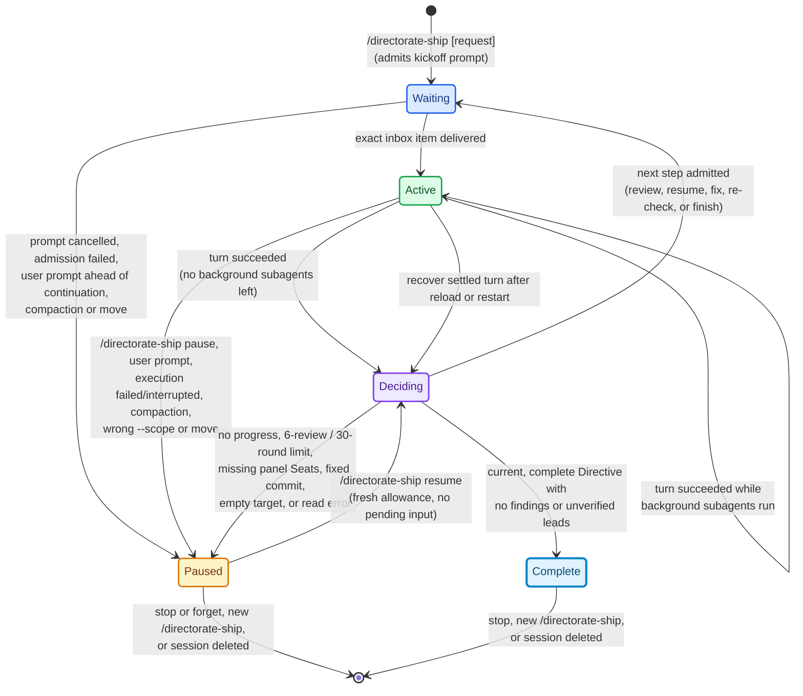
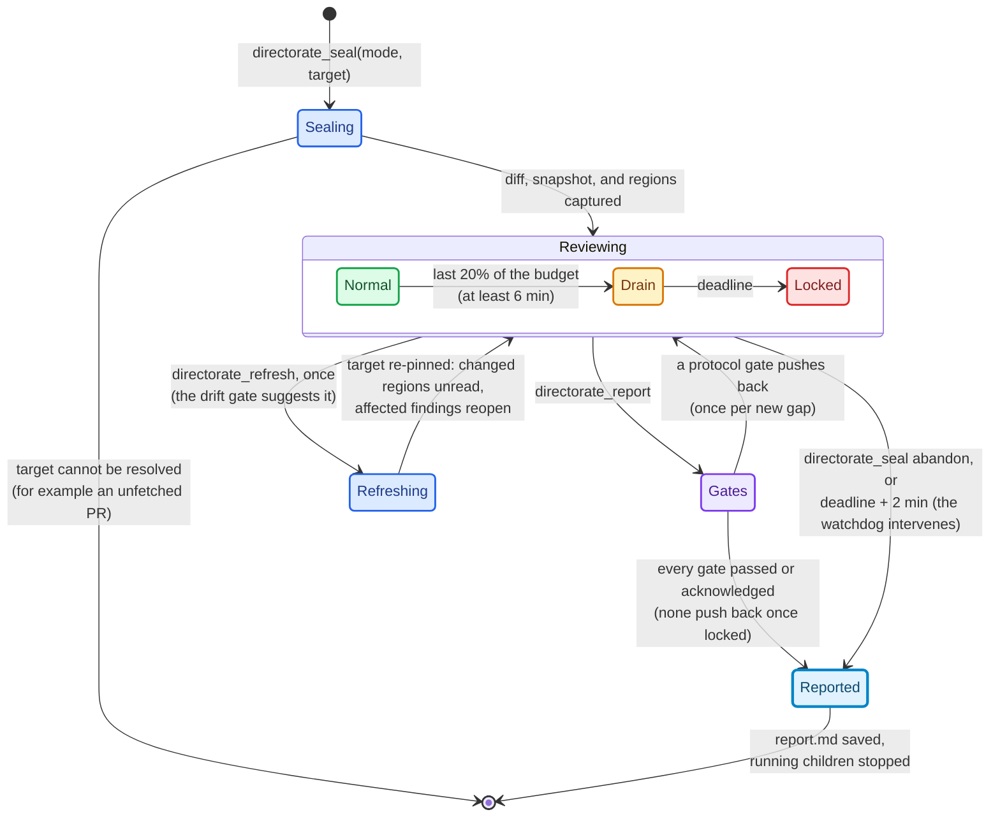
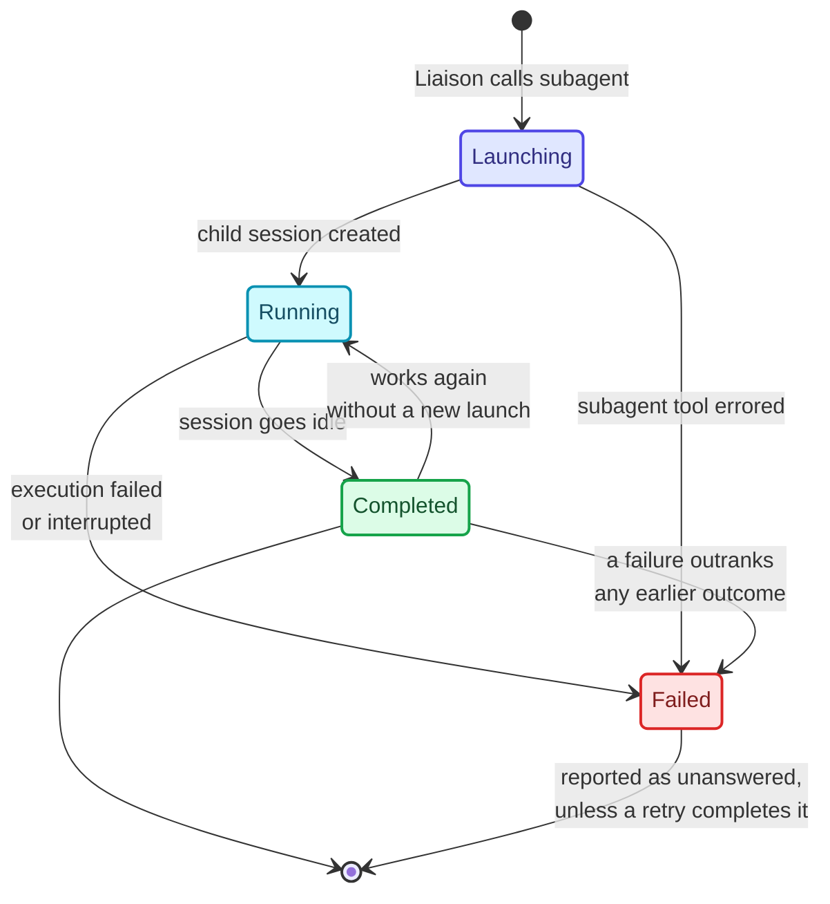
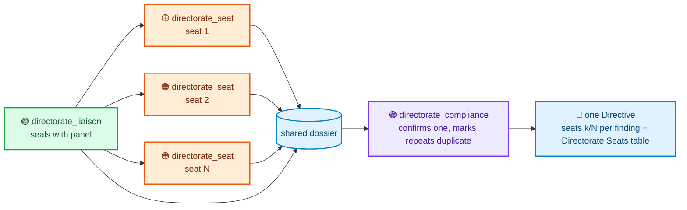
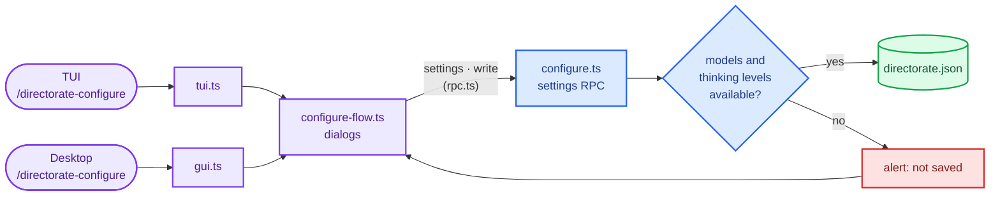
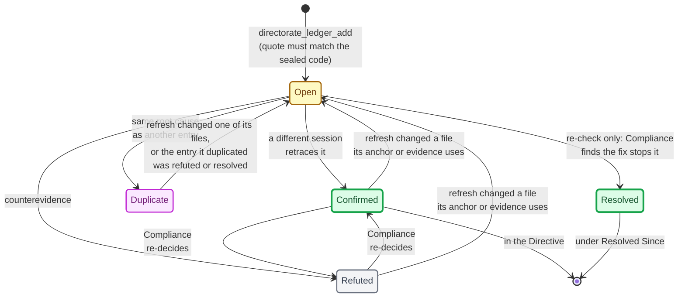
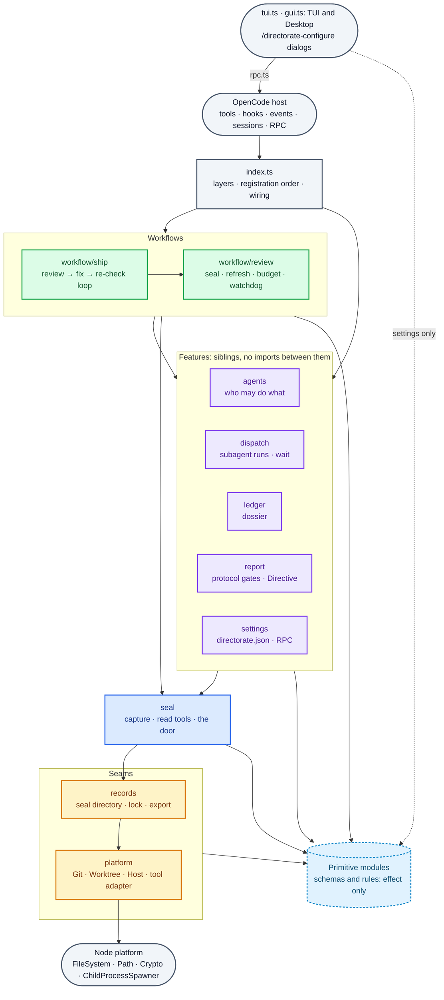

# The Directorate: evidence-gated code review for OpenCode

The Directorate (`@rc312/opencode-directorate`) is an Effect-native OpenCode plugin. It gives four agents a fixed, evidence-gated code-review workflow:

| Agent | Role | `directorate_*` tools it may call |
| --- | --- | --- |
| 🟢 `directorate_liaison` | **Liaison (Lead).** Seals the target in containment, reads every changed region, decides what to investigate, issues the Directive. | all `directorate_*` except `directorate_configure` |
| 🔵 `directorate_auditor` | **Auditor (Investigator).** Answers one narrow question and files candidate findings to the dossier. | read tools except `directorate_ledger_list`, `directorate_ledger_add`, `directorate_note` |
| 🟠 `directorate_seat` | **Directorate Seat (Panel seat).** In a panel review, reviews the whole change independently on its own model under memetic isolation. | read tools except `directorate_ledger_list`, `directorate_ledger_add`, `directorate_note` |
| 🟣 `directorate_compliance` | **Compliance (Verifier).** Confirms or refutes findings in a separate session. | read tools, `directorate_ledger_verdict` |

Read tools are `directorate_diff`, `directorate_read`, `directorate_ls`, `directorate_grep`, `directorate_history` and `directorate_ledger_list`. Agent permissions live in each agent's front matter (`agents/directorate_*.md`).

**Only the Liaison runs a review.** Any other agent (such as `build`) dispatches `directorate_liaison` with the target and focus, waits for its result, and relays the Directive verbatim. To re-check after fixing findings, it sends a follow-up to the same Liaison session (see [Re-check after fixes](#re-check-after-fixes)). The plugin enforces this:

- Agents outside The Directorate see no `directorate_*` tools except `directorate_configure`, `directorate_export`, and `directorate_export_list`, on every request kind (steps, compaction, generate), so their prompt-cache prefix stays the same. A call is denied with a pointer to the Liaison; a request that names no agent counts as the session's agent, as OpenCode resolves it.
- Only the Liaison may dispatch Auditors, Seats, and Compliance. Those three agents are `hidden`, so other agents are not offered them.
- The Liaison waits for its subagents with `directorate_wait`, inside its turn. Ending its turn to wait would hand the caller an unfinished review.

The plugin enforces the parts of a review that should not depend on judgment:

- **Containment (the seal):** what is under review is pinned (commits, or a snapshot of the working tree), so reads never drift.
- **Coverage:** every changed region must be read, or skipped with a reason.
- **Verification:** a finding reaches the Directive only after a _different session_ confirms it.
- **Freshness (Containment Drift):** a Directive on code that moved after the seal is marked stale.
- **Time:** the window drains (`EVACUATION`), then locks (`LOCKDOWN`). A watchdog intervenes and files a Directive for a Liaison that never does.

## Install from npm

Install the package in a stable location so OpenCode can load it:

```sh
npm install --global @rc312/opencode-directorate@0.1.3
package="$(npm root --global)/@rc312/opencode-directorate"
```

Use the OpenCode version declared in the installed package's `@opencode/plugin` peer dependency. Then follow the configuration below.

## Install from a checkout

This checkout targets OpenCode 2.4.2. From the workspace root, run `bun install --frozen-lockfile` and `bun run build`, then set `package="$PWD/packages/opencode-directorate"`.

### Configure OpenCode

Add the absolute path in `$package` to the `plugins` array in `~/.config/opencode/opencode.jsonc`. Set `experimental.subagent_depth` to at least `2` so the Liaison can dispatch its reviewers when called by another agent. Replace any existing Directorate entry instead of loading it twice.

```jsonc
{
  "plugins": ["/absolute/path/to/node_modules/@rc312/opencode-directorate"],
  "experimental": { "subagent_depth": 3 },
}
```

The plugin registers its four agents and the `directorate-lenses` skill when it loads. No separate installation is required. If you previously linked the bundled files into OpenCode's config directory, remove those links to let the plugin supply the definitions; existing definitions with the same IDs take precedence.

`directorate.example.json` is optional. Copy it as `directorate.json` into the global config directory only if you want those defaults and don't already have a settings file. Keep the live file separate: `/directorate-configure` replaces it on save.

## Start a review

Run `/directorate-review` from your normal OpenCode session. With no scope or target specified, it reviews the current branch's commits beyond the default branch plus staged, unstaged, and untracked changes, in every review mode. Change this under **Default review scope** in `/directorate-configure` or set `default_scope` in `directorate.json`. Project settings override global settings.

Write what you want after the command in plain language, for example `/directorate-review PR #123, focus on migration safety, use one model`. Unspecified options use your configured defaults; the agent asks only if it needs clarification to honor the request. Running the command with no arguments still offers mode and panel choices.

For an explicit scope flag, start the arguments with `--scope branch`, `--scope local` (uncommitted changes only), or `--scope repository` (including unchanged files). For example, `/directorate-review --scope local in code-quality mode`.

`/directorate-review scope to everything in packages/` reviews eligible files recursively under `packages/`, including unchanged files, instead of reviewing the branch diff. Paths are relative to the repository root; normal exclusions still apply.

## Re-check after fixes

After fixing findings, ask the agent that ran the review to re-check it, or run `/directorate-review --recheck <seal id>` (the id is on the Directive's Containment line; without it, the latest Directive is re-checked). The request goes to the same Liaison session as a follow-up when there is one, and to a new Liaison otherwise.

A re-check (`directorate_seal recheck: <id>`) is a new seal linked to the reported one, which stays as it was:

- **Same target, re-captured.** It uses the earlier review's target and mode, and keeps its base, so committing the fixes is not a new change. Commit pairs re-resolve as freshness does (a range or PR moves with its refs). It runs without a panel.
- **Only what changed is read.** Regions the earlier review read whose content did not change keep their receipts; skimmed and skipped regions are read again. The Liaison looks for new defects only in code changed since then.
- **Findings carry over.** Verified findings and unverified leads become entries of the re-check. A verified finding stays confirmed if nothing it rests on (anchor, evidence, verdict evidence) changed; otherwise it reopens, and only Compliance decides it: `confirmed` (still present, re-anchored), `resolved` (the fix stops it; evidence is the fixing lines), or `refuted` (it never held). Unverified leads always reopen.
- **The Directive compares.** Each verified finding is marked still present or new, a **Resolved Since** section lists what the fixes stopped, and the Containment line names the earlier seal.

The budget is half the mode's default, at least 10 minutes, unless `budget_minutes` is passed.

## Ship: review, fix, and re-check

Run `/directorate-ship` from the session that should edit the code. For example, `/directorate-ship --scope local focus on migration safety` reviews uncommitted changes. A bare command starts with your configured review defaults.

The Liaison reviews; your editing agent addresses every verified finding, including minor ones. The Liaison then re-checks the **specific seal** against the changed code. New or surviving findings go through the same fix and re-check cycle. After OpenCode delivers Ship's input and the session execution succeeds without a user handoff, the plugin checks the saved Directive, ledger and target fingerprint. It finishes only on a current, complete Directive with no findings or unverified leads. Ship does not commit, push, open a PR, approve, or merge.

| Command | What it does |
| --- | --- |
| `/directorate-ship status` | Show this session's progress, latest seal, and reason for stopping. |
| `/directorate-ship pause` | Suspend automatic continuations. Use OpenCode's interrupt to stop work already running. |
| `/directorate-ship resume` | Reassess the paused ship and give it a fresh allowance. |
| `/directorate-ship stop` | Remove the loop. Existing edits and filed reviews remain. |
| `/directorate-ship forget <exact-pending-id>` | Discard Ship's record if it missed a delivery or cancellation event. Confirm the exact item is no longer queued in OpenCode first. This does not cancel any input. |

While Ship is **waiting**, `status` shows the exact inbox ID and the latest OpenCode failure or interruption seen before delivery. That outcome could belong to an older input; Ship can still continue if OpenCode delivers its prompt. Cancel the exact item in OpenCode before pausing, stopping, resuming, or replacing a ship with undelivered input.

When OpenCode delivers a new ordinary user prompt after Ship's input, Ship pauses and hands control back to you. Background notices do not count as user input. Once your work is done, use `resume` to reassess and continue. The loop also pauses if a step makes no progress, an execution carrying Ship's input fails or is interrupted by the user, or the session moves. After a move, stop or replace the old ship from the session's new location rather than resuming the old review there.

Ship resumes automatically after an OpenCode reload or restart. It checks the saved seal and current working tree once the in-flight turn has settled, without resetting its limits or sending a second copy of queued input. If a crash left it unable to tell whether a continuation was queued or cancelled, Ship pauses instead of sending it again. It also pauses when a turn it missed was interrupted or failed, a user prompt arrived while the plugin was away, the review's Liaison was interrupted or its session is gone, or a subagent's completion notice never arrived. Reviews a ship started are continued only by that ship, even after it is stopped. A ship or review driven by another live OpenCode server process on the same database is left to that process. Explicit pauses still require `resume`.

If OpenCode installs a checkpoint that hides an automatic continuation or its origin after promotion, Ship pauses rather than sending fix instructions from a summary. Precomputing a summary alone does not pause Ship. Use `/directorate-ship resume` to reassess from the saved Directive; the old continuation is not needed.

Between starts or resumes, Ship allows up to six reviews before requesting another and up to 30 rounds (automatic continuations, plus the resumed step). If a requested panel did not finish, start a new panel review: a single-model re-check cannot supply the missing Seat's review.

Prefer branch or local scope for fixes: a fixed commit cannot reflect edits, and a PR re-check reads its fetched head rather than the working tree.

### The ship, as a state chart

One calling session owns one ship loop at a time. Its state lives in OpenCode plugin storage (`ship:<sessionID>`); host events and the saved review dossier move it along. `/directorate-ship stop` (when no input is queued), `/directorate-ship forget <exact-pending-id>`, or deleting the session removes the loop from any eligible state.



## The review, as a state chart

One Liaison session owns one review at a time. The seal (`seal.json`) is the state; tools move it along.



**Targets.** `auto` (local changes, plus the branch's commits beyond the default branch), `local`, `commit`, `range`, `pr`, or `paths` (whole files, for a full review). Only `local` and `paths` accept a literal file or directory restriction.

**Budget phases.** The default budget is 20, 30, or 60 minutes for `default`, `code-quality`, and `full` mode. While a seal is open, each `directorate_*` tool result about it ends with a `[DIRECTORATE // ...]` budget line telling the caller where it stands.

| Phase | Header | Starts | What changes |
| --- | --- | --- | --- |
| 🟢 **normal** | `DIRECTORATE // WINDOW` | at the seal | everything is allowed |
| 🟡 **drain** | `DIRECTORATE // EVACUATION` | in the last 20% of the budget, or the last 6 minutes if that is longer (never more than half the budget) | no new Auditors or Seats; Compliance is still allowed |
| 🔴 **locked** | `DIRECTORATE // LOCKDOWN` | at the deadline | each role keeps only its closing tools; protocol gates no longer push back |

**Protocol gates.** `directorate_report` checks five gates in order. Each one pushes back once for each new gap. Calling `directorate_report` again lets the Directive through and records the gap: the review is marked partial, or stale if containment drifted.

| Gate | Pushes back when | Resolve by |
| --- | --- | --- |
| Coverage | regions are unread | reading them with `directorate_diff`, or recording `directorate_coverage` dispositions |
| Seats (Panel) | a Directorate Seat failed, never launched, or finished with unread regions | continuing the partial Seat or relaunching a `directorate_seat` for it |
| Active Personnel (Children) | Auditors, Seats, or Compliance are still running | `directorate_wait`, which returns as each one finishes |
| Containment Drift (Freshness) | the code moved since the seal | `directorate_refresh` (allowed once; a move that is not refreshed makes the Directive stale) |
| Unverified Dossier (Open entries) | findings are unverified | verdicts, mostly from `directorate_compliance` |

**Resume.** After an OpenCode reload or restart, a review can resume in its existing Liaison session with the same seal and deadline. If the Liaison is idle after a successful turn but hasn't reported, or a restart left it mid-turn (OpenCode does not resume subagent sessions), the plugin sends one recovery prompt. Child runs that finished while the plugin was away are settled from OpenCode's record. A review you interrupted stays stopped until an explicit `directorate_seal resume`, and reviews owned by a ship are left to that ship. `directorate_seal resume: <id>` still lets another session manually take over an unreported review. On takeover in drain or locked, the clock restarts with half the current budget (at least 5 minutes). A session resuming its own review keeps its deadline unless the call explicitly passes `budget_minutes`.

### Auditors, Seats, and Compliance

Each subagent the Liaison dispatches has its own record in the seal (`src/feature/dispatch/lifecycle.ts`). A follow-up to a finished child (the subagent tool with its `sessionID`) is a new run of that session with its own record, and keeps the Seat it was launched for. Session events change only the latest run, so a failed follow-up never undoes an earlier completed one. A follow-up to a child that is still running joins that run.



### Panel reviews (Directorate Seats)

Several frontier models each review the whole change; The Directorate merges their work into one verified Directive. Ask for it with `directorate_seal panel: true` (the default seats are listed in `DEFAULT_PANEL` in `src/feature/dispatch/seat.ts`) or `panel_models: ["provider/model#variant", ...]`. A panel works with any mode, and its default budget is 1.5× the mode's.

A Seat's review is complete only when a finished session for that Seat has read every region in the current seal. A normal handoff with unread regions is reported as partial.



- **Seats are assigned by the plugin.** The Liaison launches one `directorate_seat` per seat with no `model`. The Directorate's `execute.before` hook gives each launch the next open seat's model and adds the seat to its title, so the Liaison never copies model IDs.
- **Memetic isolation (independent reads).** Coverage is tracked per reader session, so every Seat reads every region. Seats cannot list the dossier, so they don't anchor on each other's entries.
- **One verification path.** Seat entries go through Compliance like everything else. When several Seats raise the same root cause, one entry is confirmed and the rest become duplicates. The Directive credits every Seat that raised it (`seats 2/5`). Agreement is never treated as evidence.
- **The Directive** adds a `Directorate Seats` line, a `seats k/N` tag on each finding, and a **Directorate Seats** table. For each model, the table shows whether its review completed, how many entries it raised, how many were confirmed, and which confirmed findings no other seat raised. A Seat that failed or never ran is listed under Outside Containment (Not Reviewed) and makes the Directive partial.
- **Caveat:** Compliance inherits the parent session's model unless configured or launched with a model override. Verification runs in a separate session, but not necessarily on a different model.

### Settings: `/directorate-configure`

`/directorate-configure` works in the TUI and in OpenCode Desktop. Type it in the prompt or composer, or pick **Configure The Directorate** in the command palette. It opens dialogs, not an agent turn, and both apps run the same steps (`src/feature/settings/configure-flow.ts`):

1. **Pick a file:** Global Charter or Local Jurisdiction (this project).
2. **Change any of:**
   - the default review scope (`branch`, `local`, or `repository`)
   - the default mode
   - whether a panel runs by default
   - the Directorate Seats (panel models), each with a thinking level chosen from the ones that model offers
   - the time budgets
   - the disabled lenses
3. **Save.** Escape steps back, and leaving with unsaved changes asks first.

Each row shows the current value, or what an unset key falls back to. If another client saves changes to the same file while your dialog is open, reopen the dialog before applying your changes.



Neither app part reads or writes files. The settings RPC (`rpc.ts`, exported as `@rc312/opencode-directorate/rpc`) runs on the server, so with a remote server the settings land on the server's machine. The desktop app uses the server of the session in front, at that session's directory, or its own server when no session is open.

**Desktop builds.** OpenCode Desktop loads a plugin's GUI part as one prebuilt CommonJS file. `gui.ts` is built to `dist/gui-experimental.cjs` (the package's `./gui-experimental` export) with OpenCode's Vite preset (`vite.config.ts`):

- Run `bun run build` from the workspace root after changing `gui.ts` or a module it imports (`src/feature/settings/configure-flow.ts`, `src/feature/settings/rpc.ts`, and the primitives they reach). `dist/` is generated, not checked in.
- The workspace's `bun run test` builds the bundle first, then loads it the way the app does.
- The bundle needs only `effect`, `@opencode/plugin/gui` and `@opencode/plugin/rpc`, which the app provides. An agent can also change settings with the `directorate_configure` tool, when you ask it to. Directorate review agents cannot call that tool.

| File | Applies to |
| --- | --- |
| `directorate.json` in OpenCode's global config directory: `$OPENCODE_CONFIG_DIR`, else `$XDG_CONFIG_HOME/opencode`, else `~/.config/opencode` (`$DIRECTORATE_SETTINGS` overrides) | every repository |
| `<repo>/.opencode/directorate.json` | this repository; overrides the global file key by key |

```json
{
  "mode": "full",
  "panel": {
    "enabled": true,
    "models": [
      { "model": "claude-agent/opus", "variant": "high" },
      { "model": "openai/gpt-6.2-astra", "variant": "xhigh" }
    ]
  },
  "budget_minutes": { "full": 90 },
  "lenses": { "disabled": ["ux", "docs"] }
}
```

- **Precedence:** a `directorate_seal` request, then the project file, then the global file, then Directorate defaults. Asking for one model (`panel: false`) overrides `panel.enabled`.
- **Checked on write:** each panel model must be an enabled chat model in OpenCode, and each `variant` (thinking level) must be one that model offers. The dialogs offer only those. A file that names a model no longer available is refused on save, and the alert names that model.
- **Checked on read:** a hand-edited file with an unknown key or a bad value is an error, never silently ignored. `/directorate-configure` reports it instead of editing over it.
- **Budgets** set here are used as-is, including for panels. Unset budgets keep the defaults (20/30/60 minutes, 1.5× for a panel).
- **Disabled lenses** are recorded on the seal. The Liaison is told not to assign them, and `directorate_ledger_add` rejects entries filed under them.

### Findings

A finding is a dossier (ledger) entry (`ledger.json`, rules in `src/feature/ledger/decide.ts`). Only **confirmed** entries become findings in the Directive. Open entries, and duplicates of unconfirmed ones, are listed as _Unverified Leads_.



Who may decide an entry:

- `directorate_liaison` may decide open **minor** entries raised by Auditors or Seats, confirming them only as minor, and may withdraw its own open entries.
- `directorate_compliance` decides everything else and may re-decide. In a re-check, it alone decides findings carried as verified from the earlier review.
- No session can confirm or resolve an entry it raised. Only carried entries can be resolved.

## How the code is laid out

The plugin is one Effect program organized as vertical slices: each directory under `src/` owns one part of a review, with its schemas, services, tools, hooks, and prompt text kept together. Services are Effect `Context.Service`s with a `Layer`, built once when the plugin starts. `src/index.ts` builds those layers, runs each slice's registration in order, and connects the slices to each other.

- **Seams.** `platform/` wraps Git, the working tree, the OpenCode host, and the tool adapter. `records/` keeps review records (`Records`): the seal directory, its lock, retention, and export.
- **The review.** `seal/` is what is under review: capture, the read tools, and `Sessions`, the one door every write to a review goes through.
- **Features.** Five siblings that never import each other: `agents` (who may do what), `dispatch` (Auditor, Seat, and Compliance runs), `ledger` (the dossier), `report` (protocol gates and the Directive), and `settings` (`directorate.json` and its RPC).
- **Workflows.** `workflow/review` runs a review from seal to Directive; `workflow/ship` runs the review, fix, and re-check loop on top of it.

Each slice exposes one entry module (`<slice>/<slice>.ts`) and its primitive modules: schemas and rules that import only `effect`. A slice imports only the entries of slices below it, and primitives from anywhere. The TUI part (`src/tui.ts`), the desktop GUI part (`src/gui.ts`, built to `dist/`), and the RPC definition they share with the server (`src/rpc.ts`) import only settings primitives, so the GUI bundle needs nothing but `effect` and OpenCode's plugin packages. Both app parts run the same Effect workflow (`src/feature/settings/configure-flow.ts`); `src/feature/settings/configure-client.ts` bridges it to OpenCode's Promise-based UI and RPC APIs. [ARCHITECTURE.md](ARCHITECTURE.md) has the ownership rules: which slice may change which part of `seal.json`, how slices may depend on each other, and where new code goes.



A few rules hold everywhere:

- **Immutable state.** Seals and ledgers are read-only Schema types. Every change returns a new value, and only real changes are written.
- **Schemas at boundaries.** Saved JSON, tool inputs (`RepoPath`, `RepoScope`, `LineRef`), GitHub responses, and git's raw diff (`RawDiff`) are decoded with Effect Schema.
- **Withheld paths.** Secret-like files (`.env`, keys, credentials) and `.git` are redacted and never shown. Lockfiles and generated files are listed but not diffed.
- **Installed dependencies.** `directorate_read` also reads gitignored files in dependency directories (such as `node_modules`), and `directorate_ls` lists such a directory one level deep from disk, with each link's resolved target, so agents find store paths (such as Bun's `node_modules/.bun/<name>@<version>+<hash>`) instead of guessing them. Both resolve symlinks first, so Bun and pnpm store links work, and then check the resolved path (`installed` in `src/seal/content.ts`): it must stay inside the repository, be ignored, and not be secret-like.
- **Listings match reads.** For local and paths seals, `directorate_ls` lists the base tree plus the changes captured at sealing, the same files `directorate_read` serves, not the live tree. A read outside a scoped worktree seal is labeled as base content; the working-tree version was not captured.
- **Bounded output.** The reading tools stay under OpenCode's 50 KiB / 2,000-line cut, and long regions continue on the next call.

## What a seal stores

Seals live under `$DIRECTORATE_STATE_DIR`. If that is unset, they live in `$XDG_STATE_HOME/opencode-directorate`, else in `~/.local/state/opencode-directorate`. Seals not written for 31 days are removed.

```text
directorate-20261124071813-5eecd7/
├── seal.json          the state: target, SHAs, regions, children, gates, budget, filed Directive status and reasons
├── ledger.json        entries and notes
├── diff.patch         the sealed diff (diff.g1.patch after a refresh)
├── snapshot/          changed working-tree files as sealed (snapshot.g1/ after a refresh)
├── report.md          written once, when the seal is reported
├── commit.json        present only between the steps of saving the ledger and seal together
└── mutation.lock      present only while a writer holds the seal
```

## Export a review

Run `/directorate-export <seal id>` using the ID on the Directive's Containment line. Run `/directorate-export` alone to export the session's active seal, or the latest seal for the current repository if this session has none.

You can also ask in plain language, for example `/directorate-export everything in this project in the last month`. The agent lists retained reviews in the current project and its registered Git worktrees, picks the matching seals, and creates one ZIP per seal. Date ranges use when the Directive was filed (or when an open review started or last resumed); `in the last month` means the rolling last 30 days. Reviews already pruned cannot be recovered.

The command writes a ZIP to `exports/` under the Directorate state directory on the OpenCode server. It includes the seal, ledger, saved Directive, every committed patch and snapshot generation, and the available transcripts and durable event logs of the Liaison and its review agents. `manifest.json` lists the included files and any missing data. Do this before the seal is pruned; the exported ZIP is kept separately and isn't pruned with the seal.

The OpenCode server uses the `opencode` CLI on its `PATH` to read session traces. If the CLI can't access the sessions, the export still saves the review artifacts and lists unavailable traces. **Exports are always unredacted.** They can contain private source, prompts, and tool output. Inspect the ZIP before sharing it. The export is saved locally.

## Development

```sh
bun install --frozen-lockfile
bun run check  # from the workspace root; lints, checks formatting, builds the GUI, typechecks, and runs node --test
```

- **Effect version:** `effect` is a peer dependency pinned to the version the OpenCode host ships (4.1.0). The plugin uses the host's runtime and never starts its own.
- **Reloading:** use `/reload` to force OpenCode to pick up changes from this checkout.
- **Theme & copy:** see [THEME.md](THEME.md) for The Directorate's naming, vocabulary, and Dial 2.4 voice rules.
